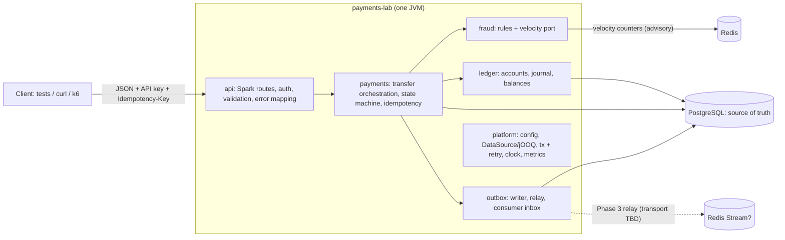
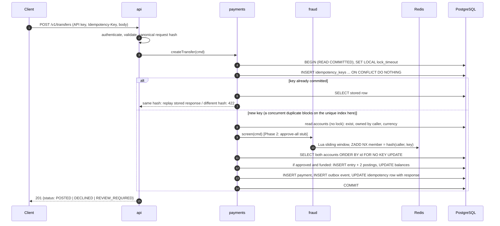
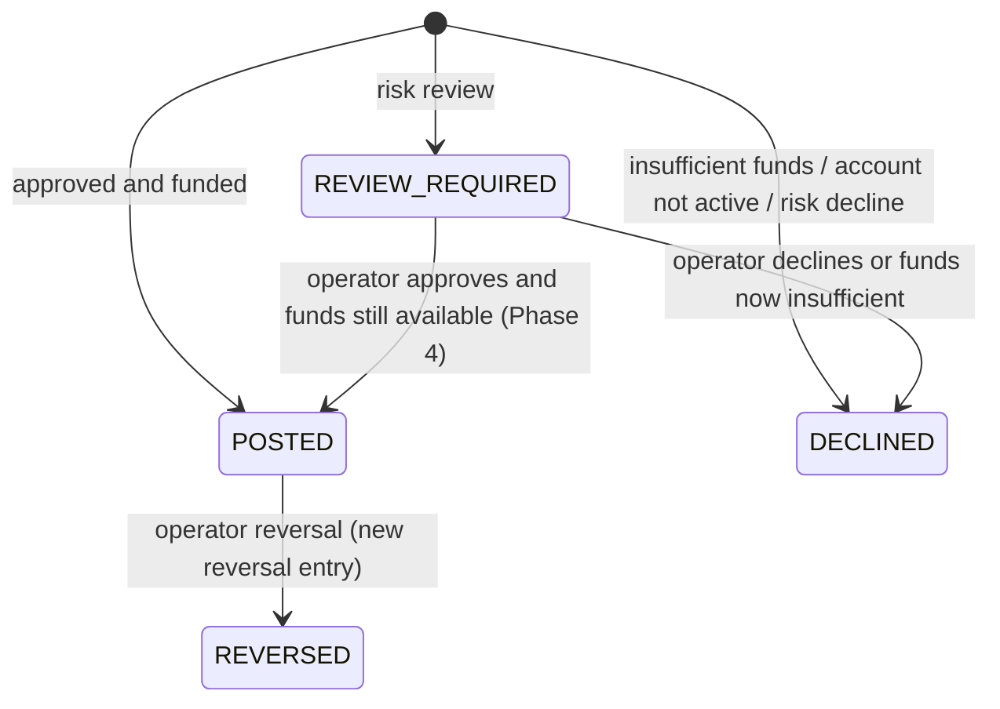

# payments-lab — Design Proposal (Phase 0)

> **Status: PROPOSAL.** Decided: D1–D4, D7, D8, D9, D11 (§15). Phase 1 and Slices 2a (ledger core),
> 2b (API keys, account reads), 2c (idempotency, account opening, fundings), 2d (transfers, concurrency), 2e (reversals) and 2f (model-based runs) are implemented and verified: **Phase 2 is complete**;
> see `PROGRESS.md`. The rest of Phase 2 is detailed in `docs/phase-2-plan.md`;
> Phases 3–6 are still a plan.
> Status labels used across the project:
> **PLANNED** = designed, no code · **IMPLEMENTED** = code exists · **VERIFIED** = a test, benchmark or
> command was run and its output captured in `PROGRESS.md`.

Working name `payments-lab`, base package `io.paymentslab`. The public repository is `ledger-sentinel-ai`
(2026-11-04); the code keeps the working name unless the student decides to rename it.

---

## 1. Goal and scope

A Java 21 modular monolith that moves **synthetic** money between internal accounts and screens
each transfer with deterministic fraud rules. The portfolio value is in three provable properties:

1. **Correctness under concurrency:** no double transfers, no overdrafts, a balanced and immutable ledger.
2. **Failure recovery:** crashes at any point lose no committed data and repeat no business effect.
3. **Reproducible performance:** benchmarks anyone can re-run, reported honestly.

**In scope:** one currency, internal account-to-account transfers, double-entry journal, idempotent API,
transactional outbox, rule-based fraud screening with Redis velocity counters, observability, local
Docker Compose, then Kubernetes (local kind/k3d only).

**Out of scope until justified:** real payment rails, multi-currency/FX, fees, interest, funds holds,
ML fraud models, Kafka or other brokers, read replicas, sharding, any real personal or financial data.

### Assumptions (challenge any of these)

| # | Assumption |
|---|---|
| A1 | Single currency **EUR** (minor-unit exponent 2). Currency is still stored on every row so multi-currency stays possible. |
| A2 | All callers, accounts and money are synthetic. Customer accounts are funded by journal entries from a SYSTEM funding account, so the books always balance. |
| A3 | A *caller* is one authenticated API client: a synthetic customer (owns one or more accounts) or an operator. |
| A4 | Transfers are synchronous: the decision and the posting finish inside the request. The one exception is `REVIEW_REQUIRED`, which waits for an operator. |
| A5 | `REVIEW_REQUIRED` does not reserve funds. Approval re-checks the balance and may still decline. |
| A6 | Maximum single transfer: 1,000,000.00 EUR (100,000,000 minor units), configurable. This also keeps JSON numbers far below 2^53. |
| A7 | One PostgreSQL primary is the only source of truth. Redis holds advisory fraud counters (and possibly the Phase 3 event stream) and is never needed to decide whether money moved. |
| A8 | Ledger timestamps come from the database (`now()` = transaction start). Fraud windows use an injectable application `Clock`. |

---

## 2. Java 21 compatibility check (done 2026-10-29)

Versions were read from Maven Central metadata and vendor pages on 2026-10-29. "Proven by Slice 1.1"
means the claim is expected to hold but only counts as VERIFIED once the first build runs on JDK 21.

| Component | Version to pin | Java 21 evidence | Notes |
|---|---|---|---|
| JDK | 21 LTS (toolchain) | — | **This machine has only JDK 25 (Homebrew). JDK 21 must be installed.** |
| SparkJava `spark-core` | 2.9.4 | Compiled for Java 8 (POM `java.version=1.8`); runs on 21 expected; proven by Slice 1.1 | ⚠️ **Last release 2022-07-10**: effectively unmaintained. Bundles Jetty 9.4.48. |
| Jetty | force 9.4.58.v20250814 | Supports Java 8+ | ⚠️ jetty.org lists the 9.4 line as **EOL**. 9.4.58 is the newest 9.4 build on Maven Central. |
| jOOQ (Open Source) | 3.21.9 + `jooq-codegen-gradle` 3.21.9 | jooq.org: OSS 3.20/3.21 ship **Java 21+** builds | Java 21 is jOOQ's *minimum* here, so we can never go below 21. |
| Spock | 2.5-groovy-4.0 | Release notes: tested on Java 25 LTS; includes a Java 21 ByteBuddy mocking fix | Test-only. |
| Groovy | 4.0.33 | Proven by Slice 1.1 | Groovy 5/6 also have Spock 2.5 builds; 4.0 is the most widely used. |
| Flyway | 13.11.1 + `flyway-database-postgresql` 13.11.1 | Proven by Slice 1.1 | PostgreSQL support has been a separate module since Flyway 10. |
| Testcontainers | 2.0.5 (`testcontainers-postgresql`, `testcontainers-spock`) | Proven by Slice 1.1 | 2.0.2 changed the default Docker API version to 1.44. This machine has Docker 29, so stay on ≥ 2.0.2. Module artifact names changed in 2.x. |
| PostgreSQL JDBC | 42.7.14 | Java 8+ | |
| HikariCP | 7.1.0 | Proven by Slice 1.1 | |
| Lettuce (Redis client) | 7.9.0.RELEASE | Proven when Redis is first used | 8.0 is still beta, so avoid it. |
| Gradle | 9.8.2 wrapper | Gradle runs on JDK 25; compiles with the 21 toolchain | Not installed. Needed once to create the wrapper. |
| PostgreSQL server | 18 (Docker) | n/a | Started on 17; moved to 18 after jOOQ reported 17.11 unsupported (D11, ADR 0003). Local `psql` client is 15.17. |
| Redis server | 8.x (Docker) | n/a | Valkey is a protocol-compatible alternative. |
| k6 | latest (Docker image `grafana/k6` or brew) | n/a | Not installed. Not needed until Phase 6. |

### SparkJava: the one real compatibility concern

SparkJava will very likely run on Java 21: it is plain Java 8 bytecode on top of Jetty 9.4. The problem
is maintenance, not bytecode:

1. **No releases since July 2022.** Security fixes and Java fixes will not arrive upstream.
2. **Its embedded Jetty 9.4 line is end-of-life.** The bundled 9.4.48 predates fixes for several
   published Jetty CVEs (for example the 2023 HTTP/2 "rapid reset" class; we do not enable HTTP/2).
   We can force all `org.eclipse.jetty:*` modules to 9.4.58, but Spark's maintainers never tested
   that combination, and the line is still EOL.
3. **Static global API (`Spark.get(...)`).** We would use the instance API (`Service.ignite()`)
   so each test starts its own server on an ephemeral port.
4. **No virtual threads in the Jetty 9.4 thread pool.** This does not hurt us: throughput is
   limited by the database connection pool, not by request threads.

**Options (not changing anything without your decision; see D1):**

| Option | Pros | Cons |
|---|---|---|
| **Keep SparkJava 2.9.4**, force Jetty 9.4.58, keep a thin HTTP adapter (no Spark types outside `api`) | Matches your stated stack; minimal and easy to read | Unmaintained, EOL Jetty; we document the risk in an ADR and a dependency scan |
| **Javalin 7.2.4** (Jetty 12, actively maintained, very similar lambda-route style) | Maintained, current Jetty, virtual-thread option | Departs from your stated stack |
| Plain Jetty 12 handlers | No framework risk | More boilerplate, less readable |

My recommendation: **if you picked SparkJava to match a target employer's stack, keep it** with the
mitigations above; if it was a free choice, switch to Javalin now, while the switch costs nothing.

---

## 3. Architecture

### 3.1 Modules (one deployable, package-level boundaries)



| Package | Owns tables | Public surface | Notes |
|---|---|---|---|
| `money` | — | `Money`, `Currency`, `TransferAmount` | Shared kernel, pure, no dependencies |
| `ledger` | `accounts`, `journal_entries`, `postings` | `LedgerService.post(...)`, `lockForPosting(...)`, account queries | Knows nothing about payments or fraud |
| `payments` | `payments`, `idempotency_keys` | `TransferService`, `PaymentStateMachine` | **Owns the transaction boundary** |
| `fraud` | (Phase 4) `fraud_decisions` | `FraudScreen.screen(...) → Decision` | Pure rules + a `VelocityStore` port (Redis adapter) |
| `outbox` | `outbox_events`, `processed_events` | `OutboxWriter.append(...)`, relay, consumer | |
| `api` | `callers` (auth) | Spark routes only | The only package that imports Spark |
| `platform` | — | `Database`, `TxRunner` (retry), `AppConfig`, `Clock` | |

**Modular-monolith trade-off:** modules share one database and, for a transfer, one transaction, but
not tables. A module touches only its own tables. Other modules reach them through its public API,
which takes the caller's transactional `DSLContext`. That is how payment + ledger + outbox commit
atomically without a distributed transaction. A boundary test (simple package-dependency check) can
enforce the rules later.

### 3.2 Transfer request flow (`POST /v1/transfers`)



**Lock acquisition order is fixed:** idempotency key first, then accounts in ascending id order. A
duplicate of key K blocks on K before it can take any account lock, so the key lock and the account
locks can never form a cycle. Two transfers A→B and B→A both lock `min(A,B)` first, so they cannot
deadlock either.

**Why fraud screening runs inside the transaction, after the idempotency insert:** a replay must never
reach the velocity counter. If we screened before the idempotency check, a replay arriving after its
counter entry had aged out of the window would be counted as a new attempt. The cost is that a DB
connection stays held during the Redis call. With a 20-connection pool and a 50 ms Redis timeout, a
Redis brownout caps throughput at roughly 20 / 0.05 s = 400 req/s. That is why the Redis timeout is
short and there is an outage policy (Phase 4). No account locks are held during the call.

---

## 4. Domain model

### 4.1 Money

- `Money(long minor, Currency currency)`. All arithmetic uses `Math.addExact` / `subtractExact`;
  overflow throws and is never silently wrapped. Combining two currencies throws.
- `Currency` is an enum of supported codes (`EUR`), so an unsupported code fails at parse time.
- `TransferAmount` wraps `Money` with `1 ≤ minor ≤ MAX_TRANSFER`.
- JSON: `"amountMinor": 2500` (integer). Floats, strings, exponents and values outside the range
  return 400. Jackson is configured to reject floats where an integer is expected.

### 4.2 Ledger: signed postings

Each `posting.amount_minor` is signed: **positive raises the account's balance, negative lowers it.**
A journal entry is balanced when its postings sum to zero. (A mapping to accounting debit/credit
terms goes in an ADR. Customer accounts are liabilities, so a customer receiving money is a credit.)

A transfer of 25.00 from A to B is one entry with postings `A −2500`, `B +2500`.
Funding a customer: `SYSTEM_FUNDING −N`, `CUSTOMER +N`. The SYSTEM account may go negative; its
negative balance equals the synthetic money issued.

### 4.3 Payment state machine



- `DECLINED` and `REVIEW_REQUIRED` payments **never** have a journal entry. The DB enforces this with
  a CHECK tying `status` to `journal_entry_id`.
- Every transition is a conditional `UPDATE ... WHERE id = ? AND status = <expected>`. Zero rows
  updated means a concurrent transition won, and we report a conflict.
- Customers see a coarse `declineReason` (`INSUFFICIENT_FUNDS`, `ACCOUNT_NOT_ACTIVE`, `RISK_DECLINED`).
  Rule-level detail is visible to operators only, so customers cannot probe the rules.

---

## 5. Invariants

Each invariant lists where it is enforced. The DB layer is a last line of defence: tests must show
that the application never relies on it (for example, a race must produce a clean `INSUFFICIENT_FUNDS`
decline, not a constraint-violation 500).

| # | Invariant | App | DB | Test |
|---|---|---|---|---|
| I1 | Money is integer minor units; arithmetic is checked; overflow is rejected | `Money` | `bigint` (errors on overflow) | unit + property |
| I2 | Transfer amount is in `[1, MAX_TRANSFER]` | `TransferAmount` | `CHECK (amount_minor > 0)` | unit, API |
| I3 | Request, both accounts, entry and postings share one supported currency | service | composite FK `(account_id, currency)` → `accounts(id, currency)`; entry trigger | integration |
| I4 | Source ≠ destination; both exist and are active; caller owns the source | service | `CHECK (source <> dest)` | API |
| I5 | Every journal entry has ≥ 2 postings summing to 0 | `LedgerService` | deferred constraint trigger | integration (direct SQL attack) |
| I6 | **Conservation:** Σ balances of all accounts per currency = 0 | — | — | invariant checker |
| I7 | **Consistency:** each `accounts.balance_minor` = Σ its postings | `LedgerService` | — | invariant checker |
| I8 | **No overdraft:** CUSTOMER balance ≥ 0 at every commit | check under row lock | `CHECK (allow_negative OR balance_minor >= 0)` | concurrency |
| I9 | Journal is append-only; a correction is one REVERSAL entry per original | service | UPDATE/DELETE triggers; `UNIQUE (reverses_id)`; Phase 5 privileges | integration |
| I10 | Payment, entry, postings, balances, outbox event and idempotency record commit together or not at all | one tx | — | fault injection |
| I11 | Per (caller, operation, key): at most one business effect; same payload → identical response; different payload → 422 | protocol §6 | PK on `idempotency_keys`; `UNIQUE (caller_id, idempotency_key)` on `payments` | concurrency |
| I12 | Payments only follow allowed transitions; DECLINED/REVIEW_REQUIRED never move money | state machine | CHECKs | unit + integration |
| I13 | Each committed state change has exactly one outbox event; delivery is at-least-once; consumers dedupe by `event_id` | — | `UNIQUE (event_id)` | Phase 3 crash tests |
| I14 | A velocity counter counts each (caller, key) attempt at most once | Lua `ZADD NX` | — | Phase 4 |

An `InvariantChecker` (SQL queries for I5–I9) runs after every integration spec, every property run,
every load test and every crash demo.

---

## 6. Idempotency protocol

**Scope:** `(caller_id, operation, idempotency_key)`, for example `transfer.create`, `account.create`,
`transfer.reverse`. The `Idempotency-Key` header is required on every POST. It must be 8–255
printable ASCII characters; clients should send a UUIDv4.

**Request fingerprint:** SHA-256 over the canonical business fields in a fixed order, with length
prefixes (operation, source, destination, amount, currency, reference). Hashing parsed fields instead
of raw bytes means whitespace or field-order differences do not count as "a different payload".

**Protocol (single transaction, recommended; see D2):** insert the key row as the first statement of
the business transaction. The row stays uncommitted until the end, so other sessions can never see a
half-finished result. PostgreSQL makes a concurrent insert of the same key **wait** on the unique
index until the first transaction commits or rolls back. That wait *is* the "in progress" lock.
(Slice 2c proves this with a real-Postgres test before anything else depends on it.)

| Situation | Behaviour |
|---|---|
| First request | Executes; response snapshot stored in the same commit |
| Repeat, same payload, after commit | Stored status and body replayed byte-for-byte, plus header `Idempotent-Replayed: true` |
| Repeat, **different payload** | `422 IDEMPOTENCY_KEY_REUSED`; the original is untouched |
| Concurrent duplicate while the first is in flight | Waits on the unique index. If the first commits: replay. If it rolls back: the duplicate executes. If `lock_timeout` (default 2 s) fires first: `409 IDEMPOTENCY_REQUEST_IN_PROGRESS` with `Retry-After: 1` |
| Failure **before** commit (crash, DB error, exhausted retries) | Nothing persisted; the key is free; a client retry executes fresh |
| **Lost response after commit** | Client retries with the same key and gets the replay |
| Validation / auth / not-found errors | Not stored (no business decision was made); retrying is deterministic |
| Business outcomes (POSTED, DECLINED, REVIEW_REQUIRED) | Stored and replayed |
| Same key, different caller or operation | Independent; no collision |
| Expiration | Response snapshots kept 7 days (configurable; purge job in Phase 5). Afterwards a transfer key still cannot create a second payment because of `UNIQUE (caller_id, idempotency_key)` on `payments`; the API returns `409 IDEMPOTENCY_KEY_EXPIRED` with the payment's URL |

**Internal retries:** the whole transaction is retried on `40P01` (deadlock), `40001` (serialization)
and `55P03` *at the account-lock step* (contention). At most 3 attempts, with exponential backoff
(10 ms · 2ⁿ, ±50% jitter). This is safe because nothing has committed. Once retries are exhausted:
`503` with `Retry-After`. A `55P03` at the idempotency-key step is not contention; it means a
duplicate is in progress, so the response is the 409 above.

**Redis is never consulted for idempotency.**

---

## 7. Concurrency and locking (see D3)

- Isolation: **READ COMMITTED** plus explicit row locks:
  `SELECT ... FROM accounts WHERE id IN (:a, :b) ORDER BY id FOR NO KEY UPDATE`.
- **Why `FOR NO KEY UPDATE`, not `FOR UPDATE`:** inserting a posting runs an FK check that takes
  `FOR KEY SHARE` on the referenced account. `FOR UPDATE` conflicts with that lock; `FOR NO KEY
  UPDATE` does not. Locking an account therefore does not block unrelated FK checks against it.
- The balance check and the update happen while holding the lock, so two competing debits are
  serialized and the second sees the first's result.
- Alternatives considered: **SERIALIZABLE** (correct without explicit locks, but a hot account causes
  abort storms and every write path needs a retry loop) and **conditional
  `UPDATE ... WHERE balance >= amt`** (fine for one row, but a two-row transfer still needs ordering;
  explicit locks make the order visible in the code).
- **Hot-account ceiling (expected, to be measured in Phase 6):** all transfers touching one account
  serialize on its row lock. Throughput through that account is at most 1 / (lock hold time). A 2 ms
  hold gives about 500 transfers/s through that account, no matter how many cores we have.

---

## 8. API contract (draft v0; becomes `docs/api/openapi.yaml` in Phase 1)

Authentication: `Authorization: Bearer <api key>`. Keys look like `pl_test_<32 random bytes, base64url>`
and are stored as SHA-256 hashes. That is adequate for high-entropy random keys; passwords would need
a slow hash. Minimal auth is needed in **Phase 2** because idempotency scoping and account ownership
depend on a trusted caller identity (see D9).

| Method | Path | Phase | Who | Notes |
|---|---|---|---|---|
| GET | `/health/live` | 1 | any | Process is up |
| GET | `/health/ready` | 1 | any | 200 if PostgreSQL is reachable. Redis status reported but non-gating (D5) |
| POST | `/v1/accounts` | 2 | customer | Creates a EUR account owned by the caller; idempotent |
| GET | `/v1/accounts/{id}` | 2 | owner | Balance and status. 404 if missing **or not owned** (no enumeration) |
| GET | `/v1/accounts/{id}/entries?cursor=&limit=` | 2 | owner | Statement with keyset pagination |
| POST | `/v1/admin/fundings` | 2 | operator | Moves synthetic funds from SYSTEM funding into an account |
| POST | `/v1/transfers` | 2 | customer (source owner) | Idempotency-Key required |
| GET | `/v1/transfers/{id}` | 2 | creator / operator | |
| POST | `/v1/transfers/{id}/reversal` | 2 | operator | Reversal entry; POSTED → REVERSED (D7) |
| POST | `/v1/admin/reviews/{id}` | 4 | operator | Approve/decline REVIEW_REQUIRED |
| GET | `/metrics` | 5 | internal | Prometheus |

**Example:**

```http
POST /v1/transfers
Authorization: Bearer pl_test_…
Idempotency-Key: 6f1c2a8e-3d0b-4c55-9f0e-0b8a7d2e9c11
Content-Type: application/json

{"sourceAccountId":"…","destinationAccountId":"…","amountMinor":2500,"currency":"EUR","reference":"rent share"}
```

```json
201 Created
{"id":"…","status":"POSTED","sourceAccountId":"…","destinationAccountId":"…",
 "amountMinor":2500,"currency":"EUR","reference":"rent share","declineReason":null,
 "createdAt":"2026-10-29T10:15:30.123Z"}
```

**A business decline is `201` with `"status":"DECLINED"`** (see D4): the API call succeeded and
created a payment resource whose outcome is negative. Errors use RFC 9457 `application/problem+json`
with a stable `code` and the `correlationId`:

| HTTP | `code` | When |
|---|---|---|
| 400 | `VALIDATION_FAILED` (with field errors), `IDEMPOTENCY_KEY_MISSING` | Malformed input |
| 401 | `UNAUTHENTICATED` | Missing or invalid key |
| 404 | `NOT_FOUND` | Missing or not owned |
| 403 | `FORBIDDEN` | Customer calling an operator endpoint (added in the OpenAPI v0 contract) |
| 409 | `IDEMPOTENCY_REQUEST_IN_PROGRESS`, `IDEMPOTENCY_KEY_EXPIRED`, `INVALID_STATE_TRANSITION` | |
| 422 | `IDEMPOTENCY_KEY_REUSED`, `INVALID_ACCOUNT_COMBINATION` (same account, currency mismatch) | |
| 503 | `CONTENTION_RETRY_EXHAUSTED`, `DEPENDENCY_UNAVAILABLE` | Always with `Retry-After` |
| 500 | `INTERNAL` | Generic body, no stack traces or SQL |

`reference` is free text, so it is limited to 140 characters, synthetic only, and **never logged**.

---

## 9. Schema (draft for Phases 1–3)

```sql
CREATE TABLE callers (
  id            uuid PRIMARY KEY,
  name          text NOT NULL UNIQUE,
  role          text NOT NULL CHECK (role IN ('CUSTOMER','OPERATOR')),
  api_key_hash  bytea NOT NULL UNIQUE,
  created_at    timestamptz NOT NULL DEFAULT now()
);

CREATE TABLE accounts (
  id             uuid PRIMARY KEY,
  owner_id       uuid REFERENCES callers(id),
  kind           text NOT NULL CHECK (kind IN ('CUSTOMER','SYSTEM')),
  currency       char(3) NOT NULL CHECK (currency IN ('EUR')),
  status         text NOT NULL DEFAULT 'ACTIVE' CHECK (status IN ('ACTIVE','FROZEN','CLOSED')),
  balance_minor  bigint NOT NULL DEFAULT 0,
  allow_negative boolean NOT NULL DEFAULT false,
  created_at     timestamptz NOT NULL DEFAULT now(),
  updated_at     timestamptz NOT NULL DEFAULT now(),
  UNIQUE (id, currency),                              -- target of the composite FK below
  CHECK (allow_negative OR balance_minor >= 0),       -- I8, last line of defence
  CHECK ((kind = 'SYSTEM') = (owner_id IS NULL)),
  CHECK (NOT allow_negative OR kind = 'SYSTEM')
);
CREATE INDEX accounts_owner_idx ON accounts (owner_id);

CREATE TABLE journal_entries (
  id          uuid PRIMARY KEY,
  kind        text NOT NULL CHECK (kind IN ('FUNDING','TRANSFER','REVERSAL')),
  currency    char(3) NOT NULL,
  reverses_id uuid UNIQUE REFERENCES journal_entries(id),   -- at most one reversal per entry
  created_at  timestamptz NOT NULL DEFAULT now(),
  CHECK ((kind = 'REVERSAL') = (reverses_id IS NOT NULL))
);

CREATE TABLE postings (
  id               bigint GENERATED ALWAYS AS IDENTITY PRIMARY KEY,
  journal_entry_id uuid   NOT NULL REFERENCES journal_entries(id),
  account_id       uuid   NOT NULL,
  currency         char(3) NOT NULL,
  amount_minor     bigint NOT NULL CHECK (amount_minor <> 0),
  FOREIGN KEY (account_id, currency) REFERENCES accounts (id, currency)   -- I3
);
CREATE INDEX postings_account_idx ON postings (account_id, id);
CREATE INDEX postings_entry_idx   ON postings (journal_entry_id);

CREATE TABLE payments (
  id                uuid PRIMARY KEY,
  caller_id         uuid NOT NULL REFERENCES callers(id),
  idempotency_key   text NOT NULL,
  source_account_id uuid NOT NULL REFERENCES accounts(id),
  dest_account_id   uuid NOT NULL REFERENCES accounts(id),
  currency          char(3) NOT NULL,
  amount_minor      bigint NOT NULL CHECK (amount_minor > 0),
  reference         text CHECK (length(reference) <= 140),
  status            text NOT NULL CHECK (status IN ('POSTED','DECLINED','REVIEW_REQUIRED','REVERSED')),
  decline_reason    text,
  journal_entry_id  uuid UNIQUE REFERENCES journal_entries(id),
  reversal_entry_id uuid UNIQUE REFERENCES journal_entries(id),
  reversed_by       uuid REFERENCES callers(id),   -- the operator (added in V6, Slice 2e; T7)
  created_at        timestamptz NOT NULL DEFAULT now(),
  updated_at        timestamptz NOT NULL DEFAULT now(),
  UNIQUE (caller_id, idempotency_key),                                    -- permanent backstop (I11)
  CHECK (source_account_id <> dest_account_id),
  CHECK ((status IN ('POSTED','REVERSED')) = (journal_entry_id IS NOT NULL)),   -- I12
  CHECK ((status = 'REVERSED') = (reversal_entry_id IS NOT NULL)),
  CHECK ((status = 'DECLINED') = (decline_reason IS NOT NULL))
);
CREATE INDEX payments_source_created_idx ON payments (source_account_id, created_at);

CREATE TABLE idempotency_keys (
  caller_id       uuid NOT NULL REFERENCES callers(id),
  operation       text NOT NULL,
  idempotency_key text NOT NULL CHECK (length(idempotency_key) BETWEEN 8 AND 255),
  request_hash    bytea NOT NULL,
  response_status int,        -- NULL only while the owning tx is uncommitted (never visible to others)
  response_body   text,       -- not jsonb: jsonb reorders keys, and replays must be byte-for-byte (changed in Slice 2c)
  resource_id     uuid,
  created_at      timestamptz NOT NULL DEFAULT now(),
  expires_at      timestamptz NOT NULL,
  PRIMARY KEY (caller_id, operation, idempotency_key)
);

-- Phase 3
CREATE TABLE outbox_events (
  id             bigint GENERATED ALWAYS AS IDENTITY PRIMARY KEY,
  event_id       uuid NOT NULL UNIQUE,
  aggregate_type text NOT NULL,
  aggregate_id   uuid NOT NULL,
  event_type     text NOT NULL,
  payload        jsonb NOT NULL,
  created_at     timestamptz NOT NULL DEFAULT now(),
  available_at   timestamptz NOT NULL DEFAULT now(),   -- backoff scheduling
  attempts       int NOT NULL DEFAULT 0,
  last_error     text,
  status         text NOT NULL DEFAULT 'PENDING' CHECK (status IN ('PENDING','PUBLISHED','DEAD')),
  published_at   timestamptz
);
CREATE INDEX outbox_pending_idx ON outbox_events (available_at, id) WHERE status = 'PENDING';
```

**Ledger guards (sketch; the exact SQL will be tested in Phase 2):**

```sql
-- I5: checked at COMMIT, so the entry and its postings can be inserted in any order inside the tx
CREATE CONSTRAINT TRIGGER postings_balanced
  AFTER INSERT ON postings DEFERRABLE INITIALLY DEFERRED
  FOR EACH ROW EXECUTE FUNCTION ledger_check_entry_balanced();
-- the function: COUNT(p.id) >= 2 AND SUM(p.amount_minor) = 0 AND every p.currency = entry currency,
-- else RAISE ... USING ERRCODE = '23514'. A twin trigger on journal_entries catches an entry with no postings.

-- I9: append-only
CREATE TRIGGER postings_append_only BEFORE UPDATE OR DELETE ON postings
  FOR EACH ROW EXECUTE FUNCTION ledger_reject_mutation();   -- likewise for journal_entries, and TRUNCATE
```

Test isolation therefore **cannot delete ledger rows**. Instead, each spec gets a fresh database cloned
from a migrated template (`CREATE DATABASE … TEMPLATE …`), which is fast and never fights the
append-only triggers.

Phase 5 adds two database roles: `payments_owner` (migrations) and `payments_app` (runtime, with
`INSERT/SELECT` on ledger tables and column-level `UPDATE` only where needed, for example
`accounts(balance_minor, updated_at)`).

---

## 10. Later-phase designs (sketches; detailed at the start of each phase)

**Phase 3, outbox.** The relay polls `outbox_events WHERE status='PENDING' AND available_at <= now()
ORDER BY id LIMIT 100 FOR UPDATE SKIP LOCKED` (several relays can run safely), publishes, then marks
the row `PUBLISHED` in a short transaction. On failure: `attempts++`,
`available_at = now() + min(2^attempts s, 5 min) ± jitter`. After N attempts: `DEAD`, plus a metric
and a log line. The consumer inserts `processed_events(event_id)` with `ON CONFLICT DO NOTHING` in the
same transaction as its effect, then acknowledges the message. The transport is open (D10): a Redis
Stream reuses existing infrastructure; an in-process queue is simpler but proves less.

Crash points to demonstrate (each has an in-process fault-injection test **and** a real `kill -9`
script, because in-process injection still runs `finally` blocks and returns pool connections):

| Crash point | Expected recovery |
|---|---|
| C1 before commit | Nothing persisted; the client's retry executes once |
| C2 after commit, before response | The client's retry gets the stored replay |
| C3 after commit, before publish | The event stays PENDING; the relay publishes it after restart |
| C4 after publish, before marking delivered | The relay republishes; the consumer dedupes by `event_id` |
| C5 consumer: after its effect commits, before ack | Redelivered; the consumer dedupes |

We will describe this as **at-least-once delivery with idempotent consumers**, never as end-to-end
exactly-once. Event order across aggregates is not guaranteed.

**Phase 4, fraud.** A pure, versioned rule set returns `APPROVE | REVIEW | DECLINE` plus the reason
codes of every rule that fired; the most severe outcome wins. Candidate rules: amount ≥ review
threshold → REVIEW; more than N attempts from one source in a sliding 60 s window → REVIEW; Σ amount
from one source in 24 h above a limit → REVIEW; first payment to a new destination above X → REVIEW.
Velocity is one Lua script, run atomically: `ZREMRANGEBYSCORE` to trim (window is `(now−w, now]`,
exclusive at the old edge), then `ZADD NX` with member = `hash(caller, key)` and score = the injected
clock time, then `ZCARD`, then `PEXPIRE`. The decision and its reason codes are stored on the payment
in the same transaction. Logs carry the decision and rule codes only: no balances, no references, no keys.
The Redis outage policy is decided in D5.

**Phase 6, provisional targets (TARGETS, not measurements).** Environment: this M1 Pro (10 cores,
16 GB), app, Postgres and Redis in Docker Desktop, k6 on the same machine. Distributed workload
(10,000 accounts, uniform pairs, 5% duplicate retries, 2% invalid requests), open-model
constant-arrival-rate: **300 transfers/s for 5 min, p99 ≤ 150 ms, non-business errors < 0.1%**. Hot
account (1% of accounts take 50% of traffic): no latency target until the first measurement; report
throughput, p99, lock waits and retries. Invariants are checked after every run. These numbers get
revised at the start of Phase 6, before any run.

---

## 11. Test strategy

- **Unit (Spock, no I/O, fast):** `Money`, `TransferAmount`, request hashing, state machine, retry
  classifier, fraud rules.
- **Integration (Spock + Testcontainers, real PostgreSQL 18 / Redis):** migrations, DB guards attacked
  with direct SQL, repositories, `TransferService`, concurrency, fault injection. Separate
  `integrationTest` source set so `./gradlew test` stays fast.
- **API (Spark on an ephemeral port + `java.net.http`):** status codes, problem+json, auth/BOLA,
  idempotency headers.
- **Concurrency harness:** N threads released together by a `CountDownLatch`; assert on outcomes
  (counts of POSTED / DECLINED / errors) *and* invariants. Each test logs its own seed and timings.
- **Property / model-based:** a seeded generator produces random operation sequences (fund, valid and
  invalid transfers, duplicate retries, reversals) run against both the real service and a tiny
  in-memory model; final balances must match and I5–I9 must hold. Failing seeds are printed for exact
  replay. (jqwik is optional for `Money` properties because it shrinks failing inputs. Slice 2f proposes not adopting
  it: a seeded generator with step-level checks and a printed trace already pinpoints the failing step, without a new
  dependency. Awaiting the student's confirmation.)
- **Test-first:** every slice starts with specs that are run and seen failing. The red run and the
  green run are both recorded in `PROGRESS.md`.

---

## 12. Phases and acceptance checklist

Each phase ends with a demo, updated docs, and a stop for your review.

### Phase 1: design and executable skeleton
- [ ] `./gradlew build` passes on a **JDK 21 toolchain** with Spock specs executing (proves Spark/jOOQ/Spock/Testcontainers on 21)
- [ ] Dependency report shows `org.eclipse.jetty:*` at 9.4.58 (if D1 = keep Spark)
- [ ] `docker compose up -d`: Postgres 18 and Redis healthy
- [ ] Flyway migrates a clean database (real PG via Testcontainers); a second run is a no-op
- [ ] jOOQ classes generated from the migrated schema and used by at least one query
- [ ] `/health/live` 200; `/health/ready` 200 with PG up and **503 within 2 s** with PG down; Redis down → still 200, body reports `redis: DOWN`
- [ ] `Money` / `TransferAmount` unit specs: construction, overflow, currency mismatch, parse rejects
- [ ] Docs: OpenAPI v0, threat model, ADRs (stack, money, ledger sign convention, locking, idempotency), README run steps, test matrix

### Phase 2: ledger and transfers
Slices: see `docs/phase-2-plan.md` (2a ledger core → 2b auth and account reads → 2c idempotency →
2d transfers and concurrency → 2e reversal → 2f model-based sequences). Reordered so idempotency
exists before any POST endpoint ships.
- [ ] **Concurrent duplicates:** 50 threads, same key and payload → exactly 1 payment, 1 entry, balances moved once, all responses identical
- [ ] **No overdraft:** balance 100, 20 concurrent transfers of 10 to different destinations → exactly 10 POSTED, 10 DECLINED(INSUFFICIENT_FUNDS), final balance 0, **zero 5xx, zero constraint-violation errors**
- [ ] **No deadlock leaks:** concurrent A→B / B→A loops → no deadlock errors reach clients; invariants hold
- [ ] **Same key, different payload** → 422; original unchanged
- [ ] **Invalid amounts** (0, −1, MAX+1, 1.5, "10", 2^63) → 400; nothing persisted
- [ ] **Rollback:** fault injected after postings, before commit → no payment, entry, posting, balance change, idempotency row or outbox row; a retry with the same key then succeeds exactly once
- [ ] **DB guards:** direct SQL attempts at an unbalanced entry, posting update/delete, currency mismatch and negative customer balance all fail
- [ ] **Property runs:** ≥ 50 seeds × 200 operations; model == database; I5–I9 hold
- [ ] Reversal creates a balancing entry, POSTED → REVERSED, and a second reversal is rejected

### Phase 3: recovery and events
- [ ] Relay with SKIP LOCKED batching, exponential backoff with jitter, DEAD after N attempts; backlog and age are observable
- [ ] Idempotent consumer with `processed_events`
- [ ] Crash points C1–C5 each demonstrated (test + kill script); afterwards every committed payment has ≥ 1 delivery and exactly one consumer effect
- [ ] Docs state at-least-once delivery, no exactly-once claim

### Phase 4: fraud screening
- [ ] Explainable, versioned rules; decision and reason codes stored with the payment
- [ ] Lua sliding window: boundary tests at `now−w` (excluded) and `now−w+1ms` (included), driven by the injected clock
- [ ] N concurrent attempts are counted exactly N; replays and retries of the same key are counted once
- [ ] Redis outage policy implemented and tested by stopping or pausing the container
- [ ] REVIEW_REQUIRED and DECLINED never create journal entries; operator review flow works
- [ ] Logs contain decisions without sensitive data; an ML-extension note covers data, leakage, evaluation and monitoring

### Phase 5: operations and security
- [ ] Auth hardening, operator role, BOLA tests on every account-scoped route, body/field limits, secrets only via env or secret files and never logged
- [ ] JSON logs with correlation id (`X-Request-Id` in and out, MDC); Micrometer/Prometheus metrics for transfer outcomes, idempotency replays and conflicts, lock retries and deadlocks, fraud decisions per rule, outbox age, backlog, retries and dead count
- [ ] Readiness semantics, migration strategy (expand/contract, run as a separate step), DB roles, audit and retention doc, idempotency purge job

### Phase 6: performance and packaging
- [ ] Benchmark spec agreed before running: environment, versions, dataset, distribution, mix, duplicate rate, arrival rate, warm-up, duration, pool sizes, ≥ 3 repetitions
- [ ] k6 distributed and hot-account scripts (constant-arrival-rate; dropped iterations reported); raw results saved; invariants checked after each run
- [ ] Report: throughput, p50/p95/p99, errors vs business declines vs timeouts, CPU/memory, PG lock waits; misses and bottlenecks stated plainly
- [ ] Local Kubernetes (kind/k3d): manifests, probes, resource limits, graceful shutdown, migration Job, PVC; kill-pod-under-load demo with an invariant check afterwards

---

## 13. First vertical slice: Slice 1.1 "walking skeleton"

**Purpose:** retire the stack risks first. One thin path must run end to end on JDK 21:
HTTP (Spark) → jOOQ (generated code) → PostgreSQL (Flyway), plus a Redis ping, all tested by Spock
with Testcontainers.

**Prerequisites (need your OK to install):** JDK 21 (`brew install openjdk@21` or Temurin 21),
Gradle once to create the wrapper (`brew install gradle`), and **Docker Desktop running** (the daemon
was not running when checked).

**Contents**
- Gradle (Kotlin DSL), version catalog with the pins from §2, Java 21 toolchain, `test` and
  `integrationTest` source sets
- `docker-compose.yml`: postgres:18 and redis:8 with health checks
- `V1__callers_and_accounts.sql` (from §9); jOOQ codegen from the migrated schema (ADR decides how)
- `money` package; `platform` (config from env, Hikari + jOOQ `DSLContext`); `api` health routes;
  `Main` with `migrate` and `serve` commands and a shutdown hook that stops Spark and closes the pool

**Specs written first (run red, then green):**
1. `MoneySpec`, `TransferAmountSpec` (unit)
2. `MigrationSpec` (Testcontainers PG): migrates cleanly; is idempotent; accounts CHECKs reject `USD`
   and a negative CUSTOMER balance; insert and read back through **generated** jOOQ classes
3. `HealthApiSpec` (Testcontainers PG + Redis, Spark on port 0): live 200; ready 200; ready 503 with
   PG stopped; ready 200 with `redis: DOWN` when Redis is stopped

**Done when:** `./gradlew clean build integrationTest` passes on JDK 21 with output captured,
`curl localhost:8080/health/ready` against compose has been captured, and the dependency report
confirms the Jetty pin. Then **stop for your review**. Slice 1.2 (docs: OpenAPI v0, threat model,
ADRs) completes Phase 1.

---

## 14. Riskiest assumptions, and how each gets retired

| # | Assumption | Why risky | Retired by |
|---|---|---|---|
| R1 | SparkJava 2.9.4 on EOL Jetty is acceptable for a banking-tech portfolio | Unmaintained; reviewers may flag it | D1 + ADR; Jetty pin; dependency scan in Phase 5 |
| R2 | The local toolchain works | JDK 21 missing (only 25); Docker daemon off; no Gradle; Docker 29 needs Testcontainers ≥ 2.0.2 | Slice 1.1 prerequisites + first green build |
| R3 | A concurrent duplicate insert blocks on the unique index and then sees the committed row under READ COMMITTED | The whole idempotency design rests on it | Slice 2c concurrency test on real PG **before** building on it |
| R4 | Ordered row locks prevent overdrafts and deadlocks; hot accounts are limited by lock hold time | Wrong locking is the classic ledger bug | Phase 2 concurrency tests; Phase 6 hot-account benchmark |
| R5 | jOOQ codegen from migrations stays simple | Needs Postgres at build time | Slice 1.1 ADR (Testcontainers in the build vs `DDLDatabase` vs committed sources) |
| R6 | In-process fault injection represents real crashes | `finally` blocks still run; connections close cleanly | Phase 3 adds real `kill -9` demos |
| R7 | Laptop benchmarks are meaningful | Docker Desktop VM, k6 sharing CPU, thermal noise | Written environment spec, repetitions, reported variance, no extrapolation |
| R8 | Six phases fit your time | A half-finished everything is weaker than a finished core | Phases 1–3 are the core story; each phase ends demo-able |
| R9 | You can defend every line | AI can write faster than you can absorb | Explain-back at each review; decision log with your rationale; authorship section in `PROGRESS.md` |

---

## 15. Decisions for you to reason through

Write your reasoning in `PROGRESS.md → Decision log`. My recommendation is given so you can argue
against it; interviewers care more about your reasoning than about which option you chose.

**Decided (by the student):** D1 keep SparkJava (ADR 0001) · D2 single transaction
(ADR 0007) · D3 ordered row locks (ADR 0006) · D8 signed amounts (ADR 0005) · D9 minimal auth in
Phase 2 (ADR 0008) · D11 PostgreSQL 18 (ADR 0003), all 2026-10-29 · D4 201 + DECLINED (ADR 0009,
2026-10-30) · D7 decline uncovered reversals, allow FROZEN accounts (ADR 0010, 2026-11-03). **Open:** D5, D6, D10.

| # | Decision | Options | My recommendation | Question to answer yourself |
|---|---|---|---|---|
| D1 | Web framework | Keep SparkJava (+Jetty pin) / Javalin 7 | Keep Spark *if* it mirrors a target employer's stack | Why this framework, and what would make you switch? |
| D2 | Idempotency protocol | Single tx (uncommitted unique row is the lock) / two-phase (committed IN_PROGRESS claim + lease) | Single tx | What kind of side effect would force two-phase? |
| D3 | Concurrency control | Ordered `FOR NO KEY UPDATE` / SERIALIZABLE + retry / conditional UPDATE | Ordered row locks | Why order by id, and why `NO KEY UPDATE`? |
| D4 | Decline over HTTP | 201 + `status=DECLINED` / 402 or 422 | 201 | Which makes replay semantics and benchmark accounting simpler? |
| D5 | Redis down | Readiness gate? Fraud: fail-open / fail-closed / route to REVIEW | Don't gate readiness; route velocity-dependent decisions to REVIEW | What does each choice cost in fraud loss vs availability? |
| D6 | What velocity counts | Distinct attempts (incl. declines) / only posted payments | Distinct attempts, deduped by (caller, key) | Should a declined attempt count against the next one? |
| D7 | Reversal when destination already spent the funds | Decline the reversal / allow negative | Decline; operator-only | Who carries the loss, and how is it handled? |
| D8 | Posting sign convention | Signed amounts / DEBIT-CREDIT direction column | Signed, with the debit/credit mapping in an ADR | Can you explain a transfer in debit/credit terms? |
| D9 | Auth timing | Minimal API-key auth in Phase 2 (deviates from your phase order) / defer to Phase 5 | Phase 2 | Why can't idempotency scoping trust an unauthenticated header? |
| D10 | Phase 3 transport | Redis Stream / in-process queue | Redis Stream | What does a real broker boundary let you demonstrate? |
| D11 | PostgreSQL major (added after Slice 1.1) | Stay on 17 / move to 18 | Move to 18 before Phase 2: jOOQ 3.21 OSS warns that its only PostgreSQL dialect targets a newer server than 17.11 | What could go wrong if the SQL builder assumes features your server lacks? |
