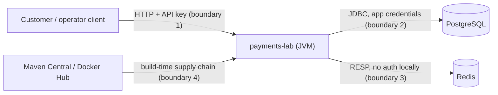

# Threat model (v0, updated for Slice 2e)

Status labels as in `PROGRESS.md`: PLANNED · IMPLEMENTED · VERIFIED (with the spec or command that proves it).
Revisit at the end of every phase.

## Scope and assumptions

- A portfolio system with **synthetic** accounts and money. No real customers, PII or payment rails.
- Runs locally (Docker Compose) and later on a local Kubernetes cluster. No internet-facing deployment.
- One PostgreSQL database is the source of truth. Redis holds advisory fraud counters only.
- TLS termination is out of scope locally. A real deployment would terminate TLS at an ingress
  and keep plain HTTP on the cluster network.

## Assets

| Asset | Why it matters |
|---|---|
| Ledger integrity: journal, postings, balances | Wrong balances are the worst possible failure |
| Idempotency records | Losing or forging them allows double transfers |
| API keys and database credentials | Grant the ability to move (synthetic) money |
| Audit trail: journal, payment rows, logs | Needed to explain every balance change |
| Fraud rule thresholds | Leaking them lets an attacker stay just under the limits |
| Availability | A payment API that hangs or crashes is a failed payment API |

## Actors

Anonymous network client · authenticated customer (malicious or buggy) · operator (insider) ·
someone else on the same LAN · a compromised or vulnerable dependency.

## Trust boundaries

## Threats and mitigations (STRIDE)

| # | Category | Threat | Mitigation | Phase | Status |
|---|---|---|---|---|---|
| T1 | Spoofing | Caller impersonates another caller | API keys (high-entropy, stored as SHA-256 hashes); every request authenticated | 2 | **VERIFIED** (2b): `AuthApiSpec` (every `/v1` operation × 9 bad-credential variants, mutation-checked), `ApiKeysSpec`, `BearerTokenSpec`, `CreateCallerCommandSpec`; rotation and revocation PLANNED (Phase 5) |
| T2 | Spoofing | Idempotency key replayed across callers to read someone else's result | Keys scoped to the *authenticated* caller and operation (ADR 0007) | 2 | **VERIFIED** (2c): the primary key is (caller, operation, key) (`IdempotencyProtocolSpec`); another caller's identical key runs as a new request (`IdempotencyApiSpec`) |
| T3 | Tampering | Amount manipulation: floats, negative, zero, overflow, wrong currency | `TransferAmount`, `SupportedCurrencies`, checked arithmetic; DB CHECKs | 1 / 2 | **VERIFIED**: `MoneySpec`, `TransferAmountSpec`, `SupportedCurrenciesSpec`, `MigrationSpec`; at the API, floats, strings, exponents, values beyond a long and lower-case currencies are rejected, never converted (`RequestBodySpec`, `FundingApiSpec`) |
| T4 | Tampering | Overdraft by racing concurrent debits | Ordered row locks (ADR 0006); the ledger refuses an overdraft before writing; `accounts_no_overdraft` CHECK as last line | 1 / 2 | CHECK **VERIFIED** (`MigrationSpec`); lock ordering **VERIFIED** at service level (`LedgerServiceSpec`, mutation-checked) and through the API (2d, `TransferConcurrencySpec`: 20 racing debits → 10 POSTED, 10 DECLINED, 0 errors; no deadlock in 100 opposite-direction transfers) |
| T5 | Tampering | Editing or deleting ledger history | Append-only triggers (UPDATE, DELETE, TRUNCATE); reversal entries only; app DB role without UPDATE/DELETE on the journal | 2 / 5 | Triggers **VERIFIED** (`LedgerGuardsSpec`); corrections are REVERSAL entries that exactly mirror the original, checked by `InvariantChecker` (I9, detection **VERIFIED** in 2e); DB role PLANNED (Phase 5) |
| T6 | Tampering | Mass assignment via unexpected JSON fields | `additionalProperties: false` in the contract; explicit DTO mapping; unknown fields rejected | 2 | Contract IMPLEMENTED; responses mapped field by field and checked for undeclared fields (`ContractSchemas`; account reads **VERIFIED**); unknown request fields rejected, never ignored **VERIFIED** (2c: `RequestBodySpec`; `ownerId` and `balanceMinor` on account opening and `fee` on funding in the API specs) |
| T7 | Repudiation | "I never made that transfer" | Payment rows record the authenticated caller; immutable journal; correlation ids; audit log | 2 / 5 | Payment rows record the authenticated caller IMPLEMENTED (2d); the reversing operator is recorded on the payment (`reversed_by`, V6) **VERIFIED** (2e, `ReversalApiSpec`); fundings record their operator only in the 7-day idempotency snapshot; correlation ids and audit log PLANNED (Phase 5) |
| T8 | Info disclosure | Probing other customers' accounts (BOLA/IDOR) | Ownership check on every account-scoped route; 404 for not-owned; BOLA specs | 2 / 5 | Account reads **VERIFIED** (2b, mutation-checked); transfers **VERIFIED** (2d, `TransferApiSpec`: someone else's source gets the same 404 as an unknown account, mutation-checked; a transfer is readable by its creator and operators only). See T25 for destination ids |
| T9 | Info disclosure | Secrets in logs | `AppConfig.toString` redacts the password; never log request bodies, `reference`, or keys | 1 / 5 | Redaction **VERIFIED** (`AppConfigSpec`, smoke-test log); API keys never logged **VERIFIED** (`AuthApiSpec`, `CreateCallerCommandSpec`, with our loggers at TRACE); logs go to stderr; transfer references never logged **VERIFIED** (2d, `TransferApiSpec`), kept out of outbox payloads, and PostgreSQL error details (which can quote rows) dropped from exception messages **VERIFIED** (`DatabaseSpec`) |
| T10 | Info disclosure | Internal errors leak SQL or stack traces | Problem+json with a generic 500 body and correlation id | 2 | **VERIFIED** (2b): `ErrorResponsesApiSpec` (a SQL failure returns a generic 500 whose correlation id matches the logged stack trace; unknown routes return problem+json). `Error`s outside Spark's handler not checked (Phase 5) |
| T11 | Info disclosure | Fraud thresholds inferred from decline details | Coarse `declineReason` for customers; rule detail for operators only | 4 | PLANNED |
| T12 | Info disclosure | API reachable by anyone on the LAN | HTTP binds 127.0.0.1 by default; Compose ports bound to 127.0.0.1 | 1 | **VERIFIED**: `HttpApiStartupSpec`; Compose ports IMPLEMENTED |
| T13 | DoS | Slow or dead database ties up request threads | 1 s pool timeout → fast failure; readiness 503 | 1 | **VERIFIED**: `HealthApiSpec` (503 within 2 s) |
| T14 | DoS | Redis brownout holds DB connections during screening | 500 ms Redis timeouts; outage policy (D5) | 1 / 4 | Timeouts IMPLEMENTED; policy PLANNED |
| T15 | DoS | Hot-account lock contention | Bounded retries, 503 + Retry-After; measured, not hidden, in Phase 6 | 2 / 6 | Retries **VERIFIED** (`TxRunnerSpec`, including a real deadlock); 100 concurrent transfers into one account all post (`TransferConcurrencySpec`); 503 mapping IMPLEMENTED; fundings serialize on the SYSTEM row (accepted); throughput measurement PLANNED (Phase 6) |
| T16 | DoS | Oversized bodies or headers | Request size and field-length limits | 5 | PLANNED |
| T17 | DoS | A port conflict kills the whole process (Spark's default `System.exit`) | Startup failure becomes an exception the caller handles | 1 | **VERIFIED**: `HttpApiStartupSpec` |
| T18 | Elevation | Customer calls operator endpoints | Role check on `/v1/admin/*` and reversals (403) | 2 / 5 | Fundings **VERIFIED** (2c, mutation-checked); reversals **VERIFIED** (2e, `ReversalApiSpec`: the sender and the receiver both get 403); operators opening accounts or creating transfers also get 403 |
| T19 | Elevation | App credentials can alter schema or history | Separate `payments_owner` (migrations) and `payments_app` (runtime) roles, column-level grants | 5 | PLANNED |
| T20 | Supply chain | Unmaintained SparkJava on EOL Jetty 9.4 | Jetty forced to 9.4.58; HTTP layer isolated; dependency scan | 1 / 5 | Pin **VERIFIED** (dependency report); scan PLANNED |
| T21 | Supply chain | Floating image tags change underneath us | Digests recorded in `PROGRESS.md`; pin by digest before Phase 6 | 1 / 6 | Digests recorded; pinning PLANNED |
| T22 | Spoofing | Unauthenticated Redis on a shared network lets anyone reset fraud counters | Redis bound to 127.0.0.1 locally; network policy and AUTH in Kubernetes | 1 / 6 | Local binding IMPLEMENTED |
| T23 | Tampering | Someone with table-owner rights disables a guard trigger, then edits history or posts unbalanced entries | `InvariantChecker` reports disabled guards and the damage they would have stopped; the app role can't ALTER tables (Phase 5) | 2 / 5 | Detection **VERIFIED** (`InvariantCheckerSpec`); role PLANNED |
| T24 | Info disclosure | A new API key printed by `create-caller` ends up in collected logs (for example a Kubernetes Job's stdout) | The key goes to stdout only and logs to stderr; run the command interactively; a `--key-file` option (mode 0600) in Phase 5 | 2 / 5 | stdout/stderr split IMPLEMENTED (smoke test); key never in the log **VERIFIED** (`CreateCallerCommandSpec`); key file PLANNED |
| T25 | Info disclosure | A customer learns whether an account id exists by sending a transfer to it (404 vs 201) | Ids are random UUIDv4 (122 random bits), so they can't be enumerated; destination validation is inherent to transfers. Accepted for now; Phase 5 rate limits slow probing | 2 / 5 | Accepted (documented) |

## Data retention and audit (outline; detailed in Phase 5)

- Journal, postings and payments: kept indefinitely (append-only by design).
- Idempotency response snapshots: 7 days, then purged; payment-level uniqueness stays.
- Application logs: no balances, references or credentials. Retention set by the log platform.

## Out of scope

Network-level DDoS, host or Docker-daemon compromise, physical access, TLS configuration, and real PII.
